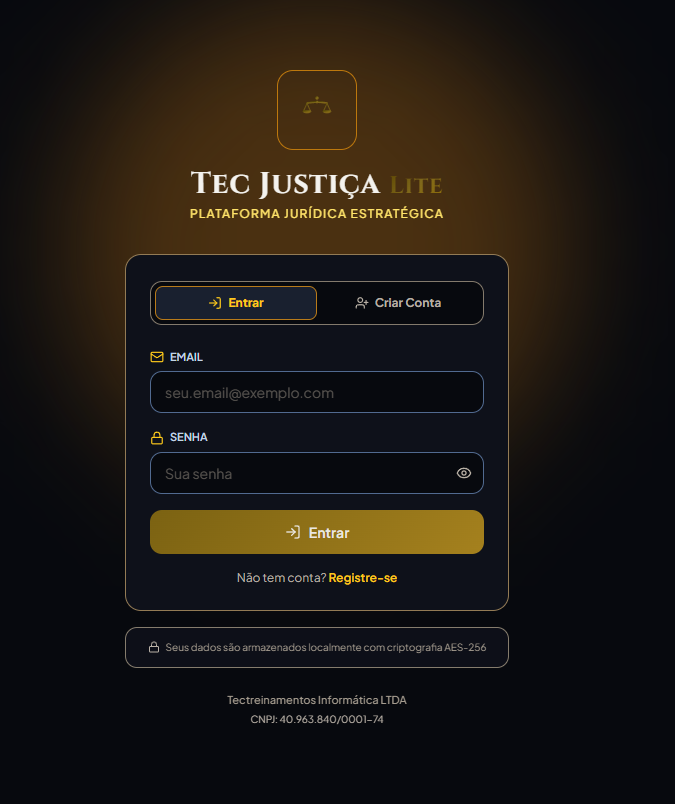
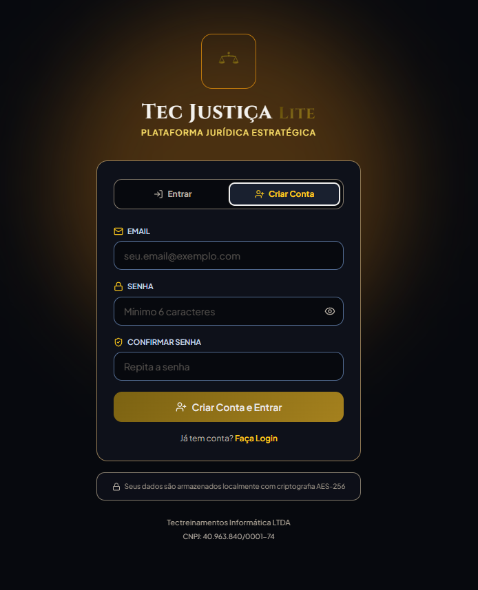
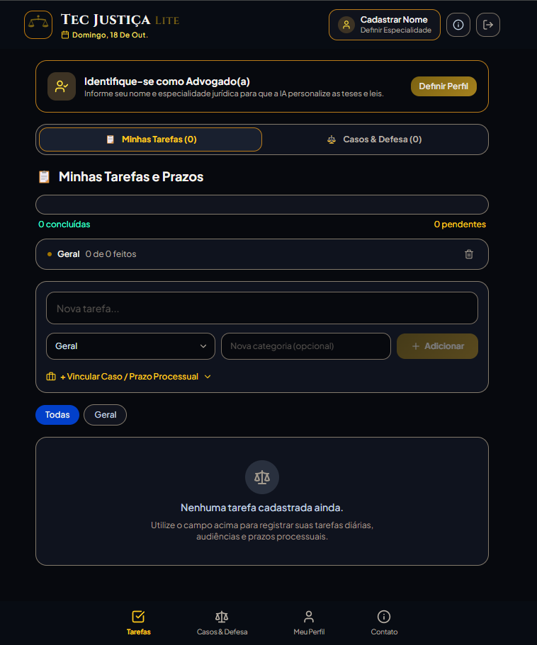
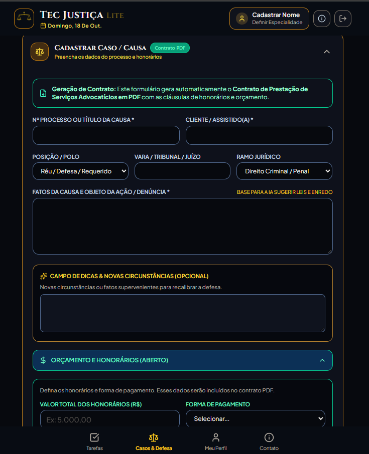

# ⚖️ Tec Justiça Lite — Assistente Jurídico Inteligente & Gestão Processual

<div align="center">


[](#)
[](#)
[](#)
[](#)
[](#)
[](#)

<p align="center">
  <strong>Plataforma jurídica de alta performance com inteligência artificial, gestão de prazos processuais, geração automatizada de teses defensivas e emissão de contratos em PDF com criptografia local de ponta a ponta.</strong>
</p>

[🎯 Visão Geral](#-descrição-detalhada-da-aplicação) •
[✨ Funcionalidades](#-principais-funcionalidades) •
[🎓 O que Aprendemos](#-o-que-aprendemos-neste-projeto) •
[🛠️ Tecnologias](#️-tecnologias-utilizadas) •
[🚀 Como Rodar](#-instalação-e-execução) •
[📁 Diretórios](#-estrutura-de-diretórios)

</div>

---

## 🎯 Descrição Detalhada da Aplicação

O **Tec Justiça Lite** é uma aplicação web moderna voltada a advogados autônomos, escritórios de advocacia e profissionais do meio jurídico brasileiro. O sistema une a praticidade do gerenciamento diário de tarefas e prazos fatais com o poder computacional da Inteligência Artificial Generativa (**Google Gemini**).

Diferente de sistemas legados complexos e lentos, o **Tec Justiça Lite** adota a filosofia **Local-First**: os dados do advogado, dos clientes, dos processos e das estratégias jurídicas são armazenados no próprio dispositivo do usuário de forma 100% criptografada (**Web Crypto API** com chave derivada por PBKDF2 e cifra **AES-GCM 256 bits** em IndexedDB).

### 🌟 Destaques do Projeto
- 🔒 **Privacidade Absoluta:** O sigilo profissional da advocacia é preservado. Não há banco de dados central bisbilhotando seus clientes.
- ⚡ **Desempenho Instantâneo:** Interface fluida, sem recarregamentos, projetada sob a estética *Dark Elegance* com acabamentos dourados refinados inspirados na tradição do Direito.
- 🤖 **Modo IA Ativado sob Demanda via `.env`:** A inteligência artificial só entra em ação se você configurar a sua chave `GEMINI_API_KEY` no arquivo `.env`, garantindo total controle de custos e privacidade.

---

## ✨ Principais Funcionalidades

### ⚖️ 1. Gestão Completa de Casos & Clientes
- Cadastro ágil de processos judiciais e inquéritos policiais.
- Informações sobre tribunal, juízo, polo do cliente (Réu, Autor, Investigado, Reclamado).
- Detalhamento de honorários acordados e forma de pagamento.

### 🤖 2. Consultoria Jurídica & Enredo de Defesa com IA (Gemini)
- **Tese Central de Defesa:** Identificação dos pontos vulneráveis da acusação ou parte contrária.
- **Estruturação de Peça:** Divisão didática em Narrativa Fática, Preliminares Processuais, Argumentação de Mérito, Estratégia de Provas e Pedidos Formais.
- **Indicação Normativa:** Sugestão comentada de dispositivos legais aplicáveis (Constituição Federal, CP, CPP, CC, CPC, CLT, Súmulas Vinculantes e Temas de Recursos Repetitivos).
- **Personalização ao Advogado:** O modelo direciona suas teses levando em conta o nome e a especialidade do Dr(a).

### 📅 3. Gestão de Tarefas e Prazos Fatais
- Organização por prioridades: *Baixa*, *Normal*, *Alta* e *Prazo Fatal*.
- Associação direta entre tarefas operacionais e os casos correspondentes.
- Filtros rápidos por categorias de atuação e status de conclusão.

### 📄 4. Emissão Instantânea de Contrato de Honorários em PDF
- Geração de minutas completas de Contratos de Prestação de Serviços Advocatícios em formato PDF pronto para impressão ou assinatura digital.
- Layout padronizado com timbre, qualificação das partes, cláusulas padrão e plano de pagamento.

### 🔒 5. Segurança & Criptografia Local
- Sistema de autenticação local com validação de senha por derivação criptográfica **PBKDF2** (100.000 iterações com Salt aleatório).
- Armazenamento em banco de dados do navegador (**IndexedDB**) cifrado com **AES-GCM 256 bits**.

---

## 🎓 O que Aprendemos Neste Projeto

Durante a concepção, desenvolvimento e refatoração desta solução, consolidamos diversos conceitos cruciais de Engenharia de Software Moderna:

1. **Arquitetura Local-First & Criptografia no Cliente (Web Crypto API):**
   - Criação de mecanismos de segurança no navegador sem depender de servidores de autenticação de terceiros.
   - Aplicação de `PBKDF2` com `SHA-256` para derivação de chaves e `AES-GCM` com vetor de inicialização (`IV`) único para cada payload gravado no `IndexedDB`.

2. **Integração com LLMs via Google Gemini API:**
   - Engenharia de prompts voltada à área jurídica, com formatação estruturada através de `responseSchema` (JSON estrito).
   - Alternância inteligente entre chamadas de cliente e proxy de servidor (`server.ts` com Express).

3. **Gerenciamento de Segredos e Variáveis de Ambiente:**
   - Remoção de injeção insegura de chaves na interface e centralização segura em arquivos `.env` ignorados pelo controle de versão (`.gitignore`).
   - Configuração de builds dinâmicos com `loadEnv` do Vite.

4. **Design System com Tailwind CSS v4 & Tipografia Especializada:**
   - Construção de uma interface com tema escuro imersivo (*Dark Palette*), efeitos de vidro (*glassmorphism*) e fontes clássicas (*Cinzel* e sans-serifs legíveis).

5. **Geração Client-Side de Documentos com jsPDF:**
   - Criação dinâmica de relatórios e contratos jurídicos de múltiplas páginas com regras de paginação, formatação monetária e layout limpo.

---

## 🛠️ Tecnologias Utilizadas

| Camada | Tecnologia | Descrição |
| :--- | :--- | :--- |
| **Frontend UI** | [React 19](https://react.dev/) | Biblioteca principal de renderização de componentes reativos |
| **Linguagem** | [TypeScript](https://www.typescriptlang.org/) | Tipagem estática rigorosa para garantir estabilidade e previsibilidade |
| **Bundler & Dev Server** | [Vite 8](https://vitejs.dev/) | Ambiente de desenvolvimento ultrarrápido com Hot Module Replacement |
| **Estilização** | [Tailwind CSS v4](https://tailwindcss.com/) | Framework de estilização utility-first de alta performance |
| **Inteligência Artificial** | [Google Gemini 3.8 Flash / 2.0](https://ai.google.dev/) | Modelo multimodal para geração de raciocínio e fundamentação jurídica |
| **Backend & Proxy** | [Node.js](https://nodejs.org/) & [Express](https://expressjs.com/) | Servidor híbrido para processamento de rotas e proxy da API Gemini |
| **Criptografia** | [Web Crypto API](https://developer.mozilla.org/en-US/docs/Web/API/Web_Crypto_API) | Criptografia nativa do navegador (AES-GCM 256 bits + PBKDF2) |
| **Banco de Dados Local** | [IndexedDB](https://developer.mozilla.org/en-US/docs/Web/API/IndexedDB_API) | Armazenamento no navegador para operação offline e segura |
| **Geração de Documentos** | [jsPDF](https://github.com/parallax/jsPDF) | Criação de contratos e relatórios jurídicos vetoriais em PDF |
| **Ícones** | [Lucide React](https://lucide.dev/) | Conjunto elegante e consistente de ícones vetoriais |

---

## 📋 Pré-requisitos e Dependências

Antes de começar, verifique se você possui os seguintes itens instalados no seu computador:

- **Node.js**: Versão `18.x` ou superior recomendada ([Download Node.js](https://nodejs.org/)).
- **NPM** (incluso com o Node) ou gerenciador de pacotes equivalente (`pnpm` / `yarn`).
- **Navegador Moderno**: Google Chrome, Microsoft Edge, Brave, Firefox ou Safari (com suporte à Web Crypto API).
- **Chave de API do Gemini (Opcional)**: Para ativar as análises automáticas com IA, obtenha uma chave gratuita no [Google AI Studio](https://aistudio.google.com/apikey).

---

## 🚀 Instalação e Execução

Siga o passo a passo abaixo para rodar o projeto localmente em sua máquina:

### 1. Clonar o repositório
```bash
git clone https://github.com/marcionavarro/udemy-antigravity-ide
cd tec-justica-lite
```

### 2. Instalar as dependências do projeto
```bash
npm install
```

### 3. Configurar as variáveis de ambiente
Copie o arquivo de exemplo [.env.example](.env.example) para `.env`:

```bash
# No Windows (PowerShell):
Copy-Item .env.example .env

# No Linux/macOS:
cp .env.example .env
```

Abra o arquivo `.env` e configure sua chave de API caso queira ativar o **Modo IA**:
```env
# Insira sua chave do Google Gemini (gratuita via AI Studio)
GEMINI_API_KEY="AIzaSyYourGeminiApiKeyHere..."

# Porta ou URL do servidor
PORT=3000
```
> [!NOTE]
> Se você não definir a `GEMINI_API_KEY`, a aplicação funcionará perfeitamente em modo de gestão local, mantendo o recurso de IA desativado.

### 4. Executar em modo de desenvolvimento
```bash
npm run dev
```

Abra seu navegador e acesse:
```
http://localhost:3000
```

### 5. Outros scripts disponíveis

```bash
# Validar tipos TypeScript
npm run lint

# Gerar o bundle otimizado de produção
npm run build

# Pré-visualizar a build de produção localmente
npm run preview
```

---

## 📸 Screenshots

<div align="center">

### 📱 Login & Cadastro

| Login  | Cadastro |
| :---: | :---: |
|  |  |

### 📄 Tarefas e Casos & Defesas
| Tarefas | Casos & Defesas |
| :---: | :---: |
| |  |

</div>

---

## 📁 Estrutura de Diretórios

```plaintext
tec-justica-lite/
├── public/                     # Arquivos estáticos e manifestos
│   ├── icons/                  # Ícones PWA (192px, 512px)
│   ├── manifest.json           # Manifesto PWA para instalação no celular/desktop
│   └── sw.js                   # Service Worker para cache e funcionamento offline
│
├── src/                        # Código-fonte da aplicação React
│   ├── components/             # Componentes modulares de interface
│   │   ├── CaseModal.tsx       # Modal de cadastro e edição de casos jurídicos
│   │   ├── CasesListView.tsx   # Listagem e filtros das causas registradas
│   │   ├── CompanyInfoModal.tsx# Dados de apoio e informações institucionais
│   │   ├── ContractExportModal.tsx # Pré-visualização e geração do contrato em PDF
│   │   ├── DefenseDrawer.tsx   # Painel lateral com teses e leis da IA
│   │   ├── Header.tsx          # Cabeçalho com perfil, data e status da IA
│   │   ├── InlineCaseForm.tsx  # Formulário rápido inline de inclusão de casos
│   │   ├── JusticeLogo.tsx     # Logotipo vetorial em SVG da balança da justiça
│   │   ├── LoginScreen.tsx     # Tela de login/registro com autenticação local
│   │   ├── Navigation.tsx      # Barra de navegação inferior flutuante
│   │   ├── ProfileModal.tsx    # Modal de dados do advogado (Nome, Especialidade, OAB)
│   │   ├── StatsProgress.tsx   # Métricas visuais de cumprimento de prazos
│   │   ├── TaskForm.tsx        # Formulário de nova tarefa/prazo processual
│   │   └── TaskList.tsx        # Lista interativa de tarefas e prazos
│   │
│   ├── services/               # Lógica de negócios, infraestrutura e integrações
│   │   ├── api.ts              # Orquestrador de requisições de IA e status do servidor
│   │   ├── authStore.ts        # Gerenciamento de sessão de usuário local
│   │   ├── contractPdf.ts      # Motor de diagramação e download de PDF com jsPDF
│   │   ├── crypto.ts           # Criptografia nativa (PBKDF2 + AES-GCM 256 bits)
│   │   ├── db.ts               # Camada de persistência IndexedDB com dados cifrados
│   │   └── geminiClient.ts     # Chamadas diretas à API do Google Gemini
│   │
│   ├── types/                  # Definições de tipos TypeScript compartilhados
│   │   └── index.ts            # Interfaces de Casos, Tarefas, Análises e Perfil
│   │
│   ├── App.tsx                 # Componente raiz com controle de fluxos e visualizações
│   ├── index.css               # Estilos globais, importação de fontes e Tailwind CSS
│   └── main.tsx                # Ponto de entrada React DOM
│
├── .env.example                # Modelo das variáveis de ambiente necessárias
├── .gitignore                  # Arquivos e pastas excluídos do versionamento Git
├── package.json                # Manifesto de dependências e scripts NPM
├── server.ts                   # Servidor Express (proxy de API e host SPA)
├── tsconfig.json               # Configurações do compilador TypeScript
└── vite.config.ts              # Configuração do Vite (plugins, aliases e env)
```

---

## 📚 Recursos e Links Úteis

- 🔑 [Google AI Studio (Obter chave gratuita do Gemini)](https://aistudio.google.com/apikey)
- 📖 [Documentação da API do Google Gemini](https://ai.google.dev/docs)
- ⚛️ [Documentação do React 19](https://react.dev/)
- ⚡ [Documentação Oficial do Vite](https://vitejs.dev/guide/)
- 🎨 [Documentação do Tailwind CSS v4](https://tailwindcss.com/docs)
- 🔐 [MDN Web Docs — Web Crypto API](https://developer.mozilla.org/en-US/docs/Web/API/Web_Crypto_API)
- 💾 [MDN Web Docs — IndexedDB API](https://developer.mozilla.org/en-US/docs/Web/API/IndexedDB_API)
- 📄 [Repositório Oficial do jsPDF](https://github.com/parallax/jsPDF)

---

<div align="center">

Desenvolvido para impulsionar a advocacia moderna com segurança, produtividade e inteligência.  
⭐ **Se este projeto foi útil, não se esqueça de deixar uma estrela no repositório!**

</div>
