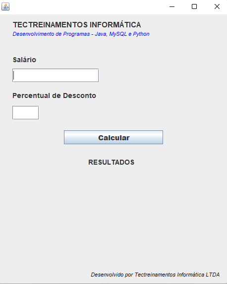
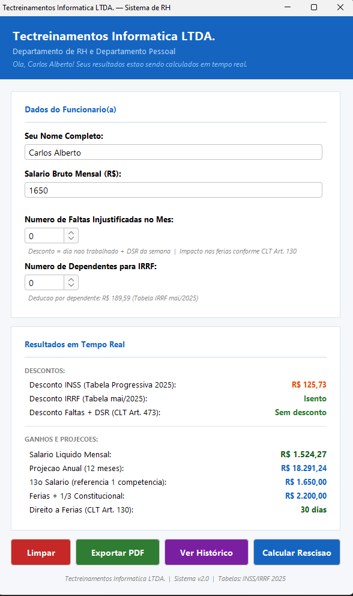
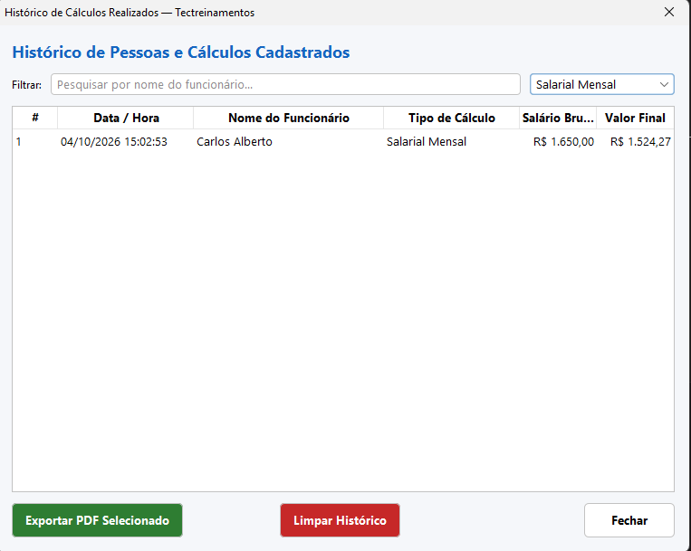
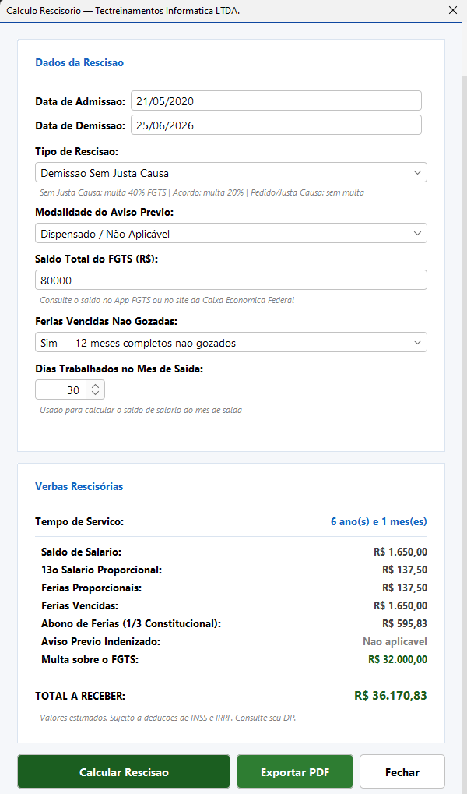

# 📄 **Projeto CalculoSalarios**

---

## ✨ Visão Geral

Este repositório contém uma aplicação Java que **calcula salários**, incluindo **rescisões**, **benefícios**, e **encargos trabalhistas**. A solução foi desenvolvida como parte de um curso da Udemy, focando em boas práticas de programação, arquitetura em camadas, e geração de relatórios em PDF.

---

## 🎓 O que Aprendemos Neste Projeto

- **Arquitetura em camadas** (view, service, model, util) para separação de responsabilidades.
- **Manipulação de PDFs** usando a biblioteca **iText**/**Apache PDFBox**.
- **Testes unitários** com **JUnit 5** e **Mockito**.
- **Gerenciamento de dependências** com **Maven**.
- **Internacionalização** (i18n) e formatação de moeda.
- **Boas práticas de código**: naming conventions, logging, e tratamento de exceções.

---

## 🛠️ Tecnologias Utilizadas

| Ícone | Tecnologia | Versão |
|---|---|---|
| ☕ | **Java** | 17 |
| 📦 | **Maven** | 3.9.6 |
| 📑 | **JUnit 5** | 5.10.0 |
| 🛡️ | **Mockito** | 5.5.0 |
| 📄 | **iText / PDFBox** | 7.2.5 |
| 📚 | **SLF4J + Logback** | 2.0.9 |

---

## 📋 Pré‑requisitos e Dependências

- **JDK 17** ou superior instalado e configurado no `PATH`.
- **Maven** (já incluído no `apache-maven` package ou via IDE).
- Sistema operacional **Windows** (conforme o ambiente de desenvolvimento atual).
- Acesso à internet para baixar as dependências Maven na primeira execução.

---

## 🚀 Instruções de Instalação e Execução

1. **Clonar o repositório**
   ```bash
   git clone https://github.com/marcionavarro/udemy-antigravity-ide.git
   cd ws-java
   ```
2. **Compilar o projeto**
   ```bash
   mvn clean compile
   ```
3. **Executar os testes (opcional, mas recomendado)**
   ```bash
   mvn test
   ```
4. **Empacotar a aplicação**
   ```bash
   mvn package
   ```
   O JAR será gerado em `target/calculo_salarios-1.0.jar`.
5. **Rodar a aplicação**
   ```bash
   java -jar target/calculo_salarios-1.0.jar
   ```
   > **Nota:** O aplicativo pode abrir uma interface Swing ou rodar em modo console, dependendo da implementação `Main`.

---

## 📸 Screenshots

### Antes da Refatoração


### Depois da Refatoração com Antigravity



---

## 📁 Estrutura de Diretórios

```text
calculo_salarios/
│
├─ src/main/java/                # Código fonte da aplicação
│   └─ calculo_salarios/
│       ├─ model/                # Classes de domínio (Calculo, Funcionario, etc.)
│       ├─ service/              # Lógica de negócio (HistoricoCalculosService, etc.)
│       ├─ util/                 # Utilitários (PdfExporter, validators, etc.)
│       └─ view/                 # Camada de apresentação (Swing dialogs, etc.)
│
├─ src/test/java/                # Testes unitários
│   └─ calculo_salarios/
│       └─ model/                # Testes de modelo
│
├─ pom.xml                        # Configuração Maven (dependências, plugins)
├─ README.md                      # Este documento
└─ .gitignore                     # Arquivos a serem ignorados no Git
```

---

## 📚 Recursos e Links Úteis

- **Documentação Java SE 17** – https://docs.oracle.com/en/java/javase/17/
- **Maven Central** – https://search.maven.org/
- **iText PDF Library** – https://itextpdf.com/
- **JUnit 5 User Guide** – https://junit.org/junit5/docs/current/user-guide/
- **Mockito Documentation** – https://site.mockito.org/
- **Curso Udemy (referência)** – *[Nome do Curso]* (adicionar link do curso)